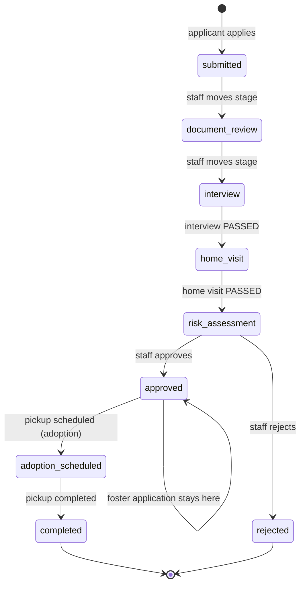

# CarePaws Adoption and Foster Workflow

How an animal goes from "Available" to "Adopted" (or fostered), who does each step, and what the system enforces.

> Written by reading the controllers in `lykasServer/src/controllers/` (`application`, `interview`, `homeVisit`, `riskAssessment`, `adoptionPickup`, `foster`) and `jobs/reminderJobs.js`. Nothing here was verified by running the server. Rules are listed as the code states them.

## At a glance

An **Application** moves through a fixed pipeline of **stages**. Each stage is advanced by a specific action. A staff member can only move it **one stage forward at a time**.

Stage list (from `Application.stage`): `submitted`, `document_review`, `interview`, `home_visit`, `risk_assessment`, `approved`, `adoption_scheduled`, `completed`, `rejected`.

`Application.status` is a simpler summary: `pending` (in progress), `approved` or `rejected`.

## Step by step

| Step | Who | What the system enforces |
|---|---|---|
| 1. Apply | Applicant (`user`, email verified) or staff on behalf of a walk-in | Pet must be `Available`. Pet must not already have a `pending` or `approved` application (also enforced by a unique index). On success the pet becomes `Pending` |
| 2. Upload documents | Applicant | Documents (`UserDocument`) are linked to the application |
| 3. Document review | Staff | Staff verify each document. Moving `submitted` to `document_review` is a manual stage change |
| 4. Interview | Staff schedule, applicant attends | Can only be scheduled while the stage is `document_review`, with at least one document and **all** application documents `verified` |
| 5. Interview result | Staff | `passed` automatically advances the stage to `home_visit`. `failed` does not advance anything |
| 6. Home visit | Staff | Can only be scheduled while the stage is `home_visit` |
| 7. Home visit result | Staff | `passed` automatically advances the stage to `risk_assessment` |
| 8. Risk assessment | Staff | Can only be created at stage `risk_assessment`, once per application. Six scores of 1 to 5 are summed (6 to 30): 24+ Low, 15-23 Medium, under 15 High |
| 9. Decision | Staff | `PUT /api/applications/:id/status` with `approved` or `rejected`. Only allowed at stage `risk_assessment` |
| 10. Pickup scheduled | Staff | Application must be `approved`. For adoptions the stage moves to `adoption_scheduled` |
| 11. Pickup completed | Staff | Adoption stage moves to `completed` and the adopter is notified |
| 12. Post-adoption monitoring | Adopter, reviewed by staff | Created automatically by a daily job (see below) |

Every stage change is appended to `Application.stageHistory` (who, when, note) and key actions are written to the audit log.

## What happens to the pet's status

| Event | Pet status becomes |
|---|---|
| Application submitted | `Pending` |
| Adoption application **approved** | `Adopted` (and `owner` set to the applicant). This happens at approval, before the pickup |
| Foster application **approved** | `Foster` (and `owner` set to the fosterer) |
| Application **rejected**, or a pending one **deleted** | `Available` (owner cleared) |
| Foster ended with outcome `ADOPTED` | `Adopted` |
| Foster ended `RETURNED` / cancelled | `Available` |

## Rules that block mistakes

- An **approved** application cannot be reopened, rejected or deleted.
- A **rejected** application cannot be reopened or re-enter the pipeline.
- A **completed** application cannot move to another stage.
- Rejection is only allowed from the `risk_assessment` stage (see Gaps below).
- A new pickup cannot be scheduled while another is `scheduled` for the same application. Cancel or reschedule instead.
- A cancelled pickup leaves the application at `adoption_scheduled` so a new one can be booked.

## Notifications sent along the way

The applicant gets an in-app notification (and a push if a token is stored) for: application status change, approval/rejection, interview scheduled/result, home visit scheduled/result, risk assessment completed, pickup scheduled/updated/cancelled/completed. Notifications are de-duplicated with a `dedupeKey`.

## Foster flow

Foster uses the **same application pipeline** (`type: "foster"`), with these differences:

1. The application stays at stage `approved` (it never goes to `adoption_scheduled` or `completed`).
2. A pickup must be scheduled **before** staff can start the placement (`POST /api/foster`). The foster start date cannot be earlier than the pickup date.
3. The placement requires an approved foster application, a pet in `Foster` status owned by that applicant, and a trial of **30 to 60 days**.
4. Weekly reports are required: `ceil(trialDays / 7)`, one per week, submitted **in order** by the fosterer and reviewed by staff.
5. Staff can extend a placement, **at most 30 extra days in total**.
6. Staff end the placement with an outcome: `ADOPTED`, `RETURNED` or `EXTENDED`. Or cancel it, which sets the pet back to `Available`.

A daily job flags missing and overdue weekly reports (below).

## Post-adoption monitoring

For every adoption application at stage `completed`, a daily job creates monitoring reports for **1, 2 and 3 months** after the completion date. A report starts as `scheduled`, becomes `pending` when due, and the adopter submits it (weight, diet, behavior, concerns, satisfaction). Staff then mark it `reviewed` or `flagged`.

## Scheduled jobs (`node-cron`, server time)

| Time | Job | What it does |
|---|---|---|
| 07:00 | `vaccination_reminders` | Notifies about vaccinations that are due |
| 07:15 | `document_expiry_reminders` | Notifies about expiring user documents |
| 07:30 | `foster_report_monitoring` | Marks missing/overdue foster weekly reports and notifies |
| 07:45 | `monitoring_report_monitoring` | Creates and updates the 1/2/3-month monitoring reports |

Super admins can also trigger any job manually (`POST /api/scheduled-jobs/:jobKey/run`). Each run is recorded in `ScheduledJobLog`.

## Payments are separate from this workflow

`Payment` supports `donation`, `adoption_fee` and `event_fee` through PayMongo checkout and webhooks. No application, pickup or approval code checks for a paid fee, so **an adoption fee does not gate the pipeline**. If your manuscript says the fee must be paid before pickup, that rule is not currently in the code.

## Gaps and things to decide

These come from reading the stage rules. They are not confirmed by running the system.

1. **A failed interview or home visit has no direct rejection path.** Rejection is only allowed from `risk_assessment`, and a failed result does not advance the stage, so the application sits at `interview` or `home_visit`. Staff can currently only delete a pending application (which frees the pet) or manually move the stage forward.
2. **Manual stage moves do not check results.** `PUT /api/applications/:id/stage` only checks that the next stage is the next in order. It does not verify that the interview or home visit actually passed, or that documents were verified, so staff can push an application forward by hand.
3. **The decision does not require a risk assessment record.** `PUT /status` requires the stage to be `risk_assessment`, but does not check that a `RiskAssessment` exists, and it does not look at the recommendation or risk level.
4. **Deleting an application loses its history.** `Application` is hard-deleted (pending/rejected only), including `stageHistory` and `internalNotes`. The code comment suggests switching to soft delete if you need to keep that audit trail.
5. **The pet is marked `Adopted` at approval,** before the handover happens. If a pickup is then cancelled or the adopter no-shows, nothing in the code puts the pet back to `Available`.
6. **No adoption fee gate** (see above).

## Endpoints involved

| Area | Endpoints |
|---|---|
| Applications | `POST /api/applications`, `GET /api/applications/my`, `PUT /api/applications/:id/stage`, `PUT /api/applications/:id/status` |
| Documents | `POST /api/documents`, `PUT /api/documents/:id/verify` |
| Interviews | `POST /api/interviews`, `PUT /api/interviews/:id/complete` |
| Home visits | `POST /api/home-visits`, `PUT /api/home-visits/:id/complete` |
| Risk assessment | `POST /api/risk-assessments` |
| Pickups | `POST /api/adoption-pickups`, `PUT /api/adoption-pickups/:id/complete` |
| Foster | `POST /api/foster`, `POST /api/foster/:fosterId/reports`, `PUT /api/foster/:id/end` |
| Monitoring | `GET /api/monitoring-reports/my`, `POST /api/monitoring-reports`, `PUT /api/monitoring-reports/:id/review` |

Who may call each one is in `ROLES_PERMISSIONS.md`. Request and response shapes are in `lykasServer/openapi.yaml`.
