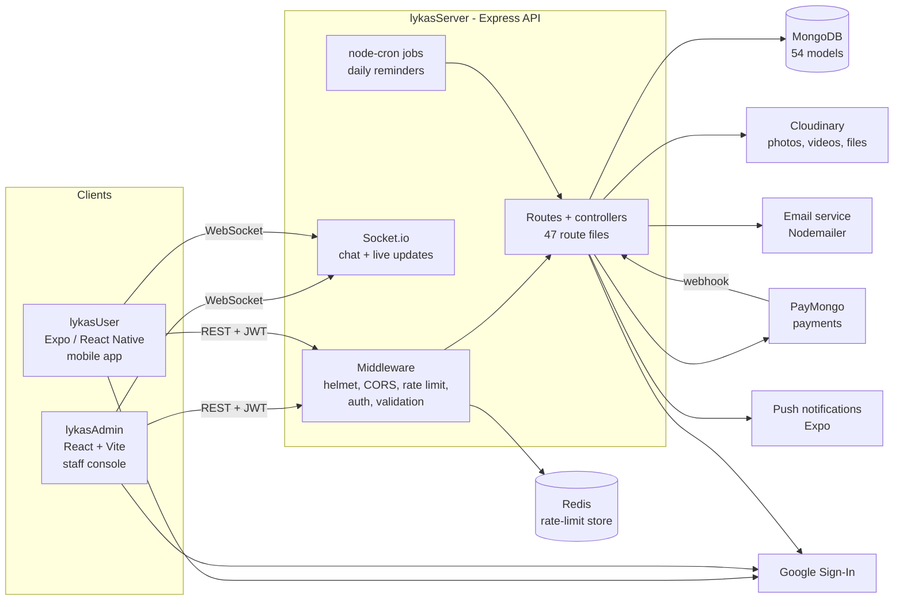

# CarePaws Architecture

CarePaws is three apps in one repository that share a single backend.

| Part | Folder | Who uses it | Stack |
|---|---|---|---|
| Backend API | `lykasServer` | Both apps | Node.js, Express 5, Mongoose 9 (MongoDB), Redis, Socket.io, zod |
| Staff console | `lykasAdmin` | Shelter staff, admins | React 19, Vite, Tailwind, React Router 7, TypeScript |
| Mobile app | `lykasUser` | Adopters, fosterers, volunteers | Expo (React Native), Expo Router, NativeWind, TypeScript |

> Versions are taken from each `package.json`. Local development is wired together by `docker-compose.yml` (MongoDB, Redis, API, admin panel). The mobile app runs separately with Expo.

## System diagram

## Backend layers (`lykasServer/src`)

| Folder | Role |
|---|---|
| `server.js` | App setup, middleware order, route mounting, Socket.io, graceful startup |
| `routes/` | One file per resource. Declares the URL, the access middleware and the handler |
| `controllers/` | Business rules (for example the adoption stage rules) |
| `validators/` | zod schemas checked by `validateRequest` before a controller runs |
| `models/` | Mongoose schemas. See `DATABASE.md` |
| `middleware/` | Auth, roles, rate limits, uploads, error handler, maintenance mode, API monitor |
| `jobs/` and `cronJob.js` | Scheduled reminder and monitoring jobs |
| `utils/` | Tokens, notifications, audit logger, query builder, realtime helper |
| `config/` | Database, Redis, Cloudinary, pet video limits, privacy version |

### Request lifecycle

1. `helmet`, CORS, JSON parsing and a request id are applied.
2. The global rate limiter (Redis) and the API monitor run on `/api/`.
3. Maintenance mode can short-circuit everything.
4. The route runs its middleware: optional limiter, `protect`, a role check, optional upload, and `validateRequest(schema)`.
5. The controller does the work and responds with the standard envelope `{ success, message, data? }`.
6. Errors go to `errorHandler`, which returns the same envelope.

## Authentication

- Email + password, or Google Sign-In.
- Short-lived JWT access token (15 min) plus a rotating refresh token (30 days) stored hashed in `Session`.
- Both clients use an Axios interceptor: on a 401 they refresh and retry once.
- Web stores tokens in `sessionStorage`. The mobile app uses `expo-secure-store`.
- Roles and enforcement: see `ROLES_PERMISSIONS.md`.

## Real-time

Socket.io shares the HTTP server. Clients connect with the same JWT. It is used for chat and for live "data changed" events so screens refresh without polling. See `REALTIME.md`.

## File handling

Clients upload `multipart/form-data` to the API. The API checks the MIME type and size, streams the file to Cloudinary, and stores the returned URL. Pet videos have their own limits (`PET_VIDEO.md`).

## Payments

The mobile app asks the API for a checkout (`POST /api/payments/create-checkout`), opens the PayMongo URL, and PayMongo calls the API's webhook when the payment changes state. The webhook verifies the signature against the raw request body and de-duplicates events with `webhookEventIds`.

## Frontends

### lykasAdmin (staff console)

Pages are in `src/pages/` and grouped by job: pets and shelter care, the adoption pipeline (applications, document review, interviews, home visits, risk assessments, pickups), fosters and monitoring, people (accounts, volunteers, adopters), money and goods (payments, donations, inventory), and system pages (audit logs, settings, content, analytics, reports). Role-gated routes hide pages the signed-in role cannot use.

### lykasUser (mobile app)

Screens use file-based routing in `app/`. Tabs: home, adopt, my applications, events, chat, favorites, profile, settings. Other screens cover pet details and applying, documents, foster dashboard and weekly reports, monitoring reports, payments and donations, emergency reports, volunteer portal, notifications and baby book.

## Deployment pieces

| Piece | Where it is defined |
|---|---|
| Local stack | `docker-compose.yml` (mongo, redis, server, admin) |
| Container builds | `Dockerfile` in `lykasServer` and `lykasAdmin` |
| Mobile builds | `eas.json`, `app.json` in `lykasUser` (Expo EAS) |
| CI | `.github/` folders in each app |
| Environment variables | `.env.example` in each app, and `SETUP.md` |

## Where to read next

- `SETUP.md`: install and run
- `docs/DATABASE.md`: data model
- `docs/ROLES_PERMISSIONS.md`: access rules
- `docs/ADOPTION_WORKFLOW.md`: the core business process
- `lykasServer/openapi.yaml`: API reference
