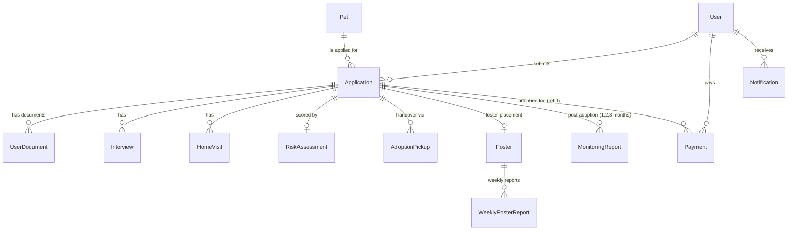
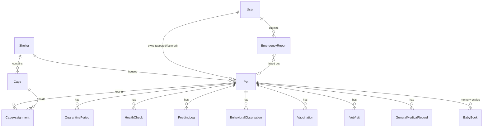
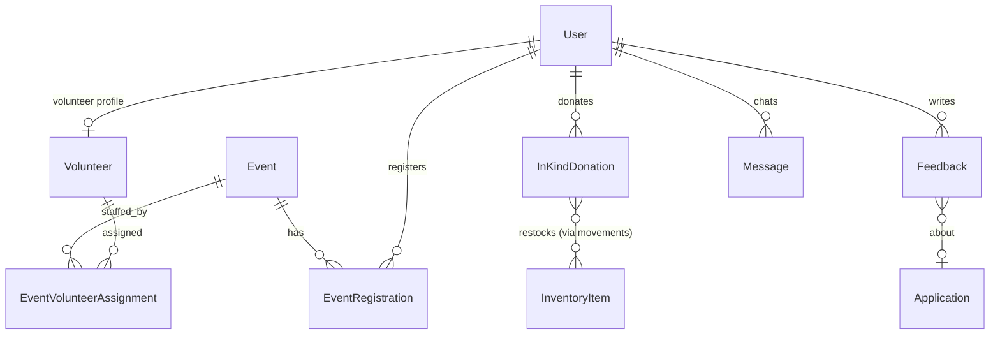

# CarePaws Database Reference

MongoDB, accessed through Mongoose. This document describes all **54** models (collections) in `lykasServer/src/models/`.

> Generated from the Mongoose schemas by loading every model and reading its paths, so field names, types, enums and indexes match the code at the time of writing. If you change a schema, update this file (or regenerate it).

## Contents

- [Conventions](#conventions)
- [Entity relationship diagrams](#entity-relationship-diagrams)
- [Accounts & security](#accounts--security)
- [Pets & shelter operations](#pets--shelter-operations)
- [Medical records](#medical-records)
- [Adoption & foster pipeline](#adoption--foster-pipeline)
- [Payments & donations](#payments--donations)
- [Community](#community)
- [Communication & content](#communication--content)
- [Platform administration](#platform-administration)

## Conventions

- **IDs**: every document has a MongoDB `_id` (ObjectId). Relationships are stored as ObjectId references (`ref`), not embedded copies, unless noted as *Embedded*.
- **Timestamps**: almost every model has `createdAt` and `updatedAt` (Mongoose `timestamps: true`). They are omitted from the tables below to keep them short.
- **Soft delete**: these models use `isDeleted` / `deletedAt` / `deletedBy`: `FileAsset`, `InKindDonation`, `Pet`, `User`, `Volunteer`. A normal delete archives; only `super_admin` can permanently delete where an endpoint exists.
- **Hard delete exception**: `Application` is hard-deleted (pending/rejected only). Approved applications cannot be deleted.
- **Hidden fields**: fields marked *hidden by default* use `select: false` and are only loaded when a query asks for them (passwords, tokens, hashes).
- **Enums are the contract**: the Mongoose enum, the zod validator in `src/validators/`, the frontend dropdowns and `openapi.yaml` should list the same values.

## Entity relationship diagrams

Only the key relationships are drawn, to stay readable. Full field lists are in the sections below.

### Adoption and foster pipeline

### Pets, shelter and care

### Community, volunteers and donations

## Accounts & security

Who can log in, and the session/audit data around them.

### User

Collection: `users`  |  soft delete

| Field | Type | Notes |
|---|---|---|
| `displayName` | String | required |
| `email` | String | required; unique |
| `password` | String | hidden by default; bcrypt hash (cost 12). Never returned by default |
| `passwordChangedAt` | Date |  |
| `privacyAccepted` | Boolean | default false |
| `privacyAcceptedAt` | Date |  |
| `privacyPolicyVersion` | String |  |
| `emailVerified` | Boolean | default false |
| `emailVerificationToken` | String | hidden by default |
| `emailVerificationExpires` | Date | hidden by default |
| `emailVerificationLastSentAt` | Date | hidden by default |
| `emailVerificationWindowStartedAt` | Date | hidden by default |
| `emailVerificationSendCount` | Number | hidden by default |
| `resetPasswordToken` | String | hidden by default |
| `resetPasswordExpires` | Date | hidden by default |
| `role` | String | one of: `user`, `staff`, `admin`, `super_admin`; default "user" |
| `status` | String | one of: `active`, `suspended`, `locked`; default "active" |
| `lockedUntil` | Date |  |
| `failedLoginAttempts` | Number | default 0 |
| `profilePicture` | String |  |
| `notificationsEnabled` | Boolean | default true |
| `pushToken` | String |  |
| `favorites` | [ObjectId -> Pet] | Array of Pet ids |
| `volunteerHours` | Number | default 0 |
| `phone` | String |  |
| `address` | String |  |
| `phoneVerified` | Boolean | default false |
| `addressConfirmed` | Boolean | default false |
| `identityVerificationStatus` | String | one of: `unverified`, `pending`, `verified`, `rejected`; default "unverified" |
| `identityVerifiedBy` | ObjectId -> User |  |
| `identityVerifiedAt` | Date |  |
| `identityVerificationNotes` | String |  |
| `isDeleted` | Boolean | default false |
| `deletedAt` | Date |  |
| `deletedBy` | ObjectId -> User |  |

Indexes: `email` **unique**; `role`; `status`; `isDeleted`

### Session

Collection: `sessions`

| Field | Type | Notes |
|---|---|---|
| `user` | ObjectId -> User | required |
| `refreshTokenHash` | String | required; hidden by default |
| `ipAddress` | String |  |
| `userAgent` | String |  |
| `lastActiveAt` | Date |  |
| `expiresAt` | Date | required |
| `revoked` | Boolean | default false |
| `revokedAt` | Date |  |

Indexes: `user`; `user, revoked`

### TokenBlacklist

Collection: `tokenblacklists`

| Field | Type | Notes |
|---|---|---|
| `token` | String | required; unique |
| `userId` | ObjectId -> User |  |
| `expiresAt` | Date | required |
| `reason` | String | required; one of: `logout`, `account_suspended`, `account_locked`, `password_changed` |

Indexes: `token` **unique**; `userId`; `expiresAt`

### LoginHistory

Collection: `loginhistories`

| Field | Type | Notes |
|---|---|---|
| `user` | ObjectId -> User |  |
| `email` | String |  |
| `success` | Boolean | required |
| `reason` | String |  |
| `ipAddress` | String |  |
| `userAgent` | String |  |

Indexes: `user`

### DailyVisit

Collection: `dailyvisits`

| Field | Type | Notes |
|---|---|---|
| `user` | ObjectId -> User | required |
| `day` | String | required |

Indexes: `user, day` **unique**; `day`; `createdAt`

### Role

Collection: `roles`

| Field | Type | Notes |
|---|---|---|
| `key` | String | required; unique |
| `label` | String | required |
| `description` | String | default "" |
| `permissions` | [String] |  |
| `isSystem` | Boolean | default false |

Indexes: `key` **unique**

### ApiKey

Collection: `apikeys`

| Field | Type | Notes |
|---|---|---|
| `name` | String | required |
| `keyHash` | String | required; hidden by default |
| `prefix` | String | required |
| `scopes` | [String] |  |
| `createdBy` | ObjectId -> User | required |
| `lastUsedAt` | Date |  |
| `expiresAt` | Date |  |
| `revoked` | Boolean | default false |
| `revokedAt` | Date |  |

## Pets & shelter operations

Animals, where they are kept, and day-to-day care records.

### Pet

Collection: `pets`  |  soft delete

| Field | Type | Notes |
|---|---|---|
| `name` | String | required |
| `species` | String | required; one of: `Dog`, `Cat`, `Other` |
| `breed` | String | default "" |
| `age` | Number |  |
| `gender` | String | one of: `Male`, `Female` |
| `size` | String | one of: `Small`, `Medium`, `Large` |
| `weight` | Number |  |
| `temperament` | String | one of: `Calm`, `Playful`, `Shy`, `Energetic`, `Affectionate`, `Independent` |
| `energyLevel` | String | one of: `Low`, `Medium`, `High` |
| `healthStatus` | String | default "" |
| `description` | String | default "" |
| `imageUrl` | String |  |
| `video` | Embedded | Embedded: `{url, thumbnailUrl, publicId, duration, mimeType, size, width, height, uploadedAt}` |
| `status` | String | one of: `Available`, `Pending`, `Adopted`, `Foster`; default "Available" |
| `owner` | ObjectId -> User |  |
| `shelterId` | ObjectId -> Shelter |  |
| `isDeleted` | Boolean | default false |
| `deletedAt` | Date |  |
| `deletedBy` | ObjectId -> User |  |

Indexes: `status`; `shelterId`; `isDeleted`; `status, species`; `name (text), breed (text), description (text)`

### Shelter

Collection: `shelters`

| Field | Type | Notes |
|---|---|---|
| `name` | String | required |
| `address` | String | required |
| `coordinates.lat` | Number |  |
| `coordinates.lng` | Number |  |
| `contactPerson` | String |  |
| `contactPhone` | String |  |
| `contactEmail` | String |  |
| `capacity` | Number | default 0 |
| `currentOccupancy` | Number | default 0 |
| `type` | String | required; one of: `main_shelter`, `foster_hub`, `clinic`, `satellite` |
| `status` | String | one of: `active`, `at_capacity`, `under_maintenance`, `inactive`; default "active" |
| `operatingHours` | String |  |
| `notes` | String |  |
| `manager` | ObjectId -> User |  |
| `createdBy` | ObjectId -> User |  |

### Cage

Collection: `cages`

| Field | Type | Notes |
|---|---|---|
| `shelterId` | ObjectId -> Shelter | required |
| `cageNumber` | String | required |
| `section` | String | default "" |
| `capacity` | Number | required; default 1 |
| `status` | String | one of: `active`, `maintenance`, `inactive`; default "active" |
| `quarantineOnly` | Boolean | default false |
| `allowedSpecies` | [String] |  |
| `notes` | String | default "" |
| `createdBy` | ObjectId -> User | required |

Indexes: `shelterId`; `status`; `shelterId, cageNumber` **unique**

### CageAssignment

Collection: `cageassignments`

| Field | Type | Notes |
|---|---|---|
| `pet` | ObjectId -> Pet | required |
| `cageId` | ObjectId -> Cage |  |
| `cageNumber` | String | required |
| `section` | String |  |
| `assignedBy` | ObjectId -> User | required |
| `assignedAt` | Date |  |
| `releasedAt` | Date |  |
| `isActive` | Boolean | default true |
| `notes` | String |  |

Indexes: `pet`; `cageId`; `pet` **unique** (partial)

### QuarantinePeriod

Collection: `quarantineperiods`

| Field | Type | Notes |
|---|---|---|
| `pet` | ObjectId -> Pet | required |
| `startDate` | Date | required |
| `endDate` | Date |  |
| `reason` | String | required |
| `isActive` | Boolean | default true |
| `startedBy` | ObjectId -> User | required |
| `endedBy` | ObjectId -> User |  |
| `notes` | String |  |

Indexes: `pet`

### HealthCheck

Collection: `healthchecks`

| Field | Type | Notes |
|---|---|---|
| `pet` | ObjectId -> Pet | required |
| `checkedBy` | ObjectId -> User | required |
| `date` | Date |  |
| `weight` | Number |  |
| `temperature` | Number |  |
| `condition` | String | required; one of: `Excellent`, `Good`, `Fair`, `Poor`, `Critical` |
| `notes` | String |  |
| `flagged` | Boolean | default false |

Indexes: `pet`

### FeedingLog

Collection: `feedinglogs`

| Field | Type | Notes |
|---|---|---|
| `pet` | ObjectId -> Pet | required |
| `loggedBy` | ObjectId -> User | required |
| `date` | Date |  |
| `meal` | String | required; one of: `Morning`, `Afternoon`, `Evening` |
| `foodType` | String |  |
| `amount` | String |  |
| `eaten` | String | one of: `All`, `Most`, `Half`, `Little`, `None`; default "All" |
| `notes` | String |  |

Indexes: `pet`

### BehavioralObservation

Collection: `behavioralobservations`

| Field | Type | Notes |
|---|---|---|
| `pet` | ObjectId -> Pet | required |
| `observedBy` | ObjectId -> User | required |
| `date` | Date |  |
| `mood` | String | required; one of: `Happy`, `Calm`, `Anxious`, `Aggressive`, `Lethargic`, `Playful` |
| `sociability` | String | required; one of: `Friendly`, `Neutral`, `Shy`, `Aggressive` |
| `notes` | String |  |
| `flagged` | Boolean | default false |

Indexes: `pet`

### BabyBook

Collection: `babybooks`

| Field | Type | Notes |
|---|---|---|
| `pet` | ObjectId -> Pet | required |
| `addedBy` | ObjectId -> User | required |
| `date` | Date |  |
| `title` | String | required |
| `content` | String |  |
| `category` | String | one of: `Milestone`, `Health`, `Funny Moment`, `Training`, `First Time`, `General`; default "General" |
| `photoUrl` | String |  |

Indexes: `pet`

## Medical records

Per-pet medical history.

### Vaccination

Collection: `vaccinations`

| Field | Type | Notes |
|---|---|---|
| `pet` | ObjectId -> Pet | required |
| `vaccineName` | String | required |
| `dateGiven` | Date | required |
| `nextDueDate` | Date |  |
| `administeredBy` | String |  |
| `batchNumber` | String |  |
| `notes` | String |  |
| `recordedBy` | ObjectId -> User |  |

Indexes: `pet`

### VetVisit

Collection: `vetvisits`

| Field | Type | Notes |
|---|---|---|
| `pet` | ObjectId -> Pet | required |
| `visitDate` | Date | required |
| `reason` | String |  |
| `vetName` | String |  |
| `clinic` | String |  |
| `diagnosis` | String |  |
| `treatment` | String |  |
| `prescription` | String |  |
| `followUpDate` | Date |  |
| `cost` | Number |  |
| `notes` | String |  |
| `recordedBy` | ObjectId -> User |  |

Indexes: `pet`

### GeneralMedicalRecord

Collection: `generalmedicalrecords`

| Field | Type | Notes |
|---|---|---|
| `pet` | ObjectId -> Pet | required |
| `type` | String | required; one of: `Surgery`, `Deworming`, `Flea Treatment`, `Dental`, `Spay/Neuter`, `Injury`, `Illness`, `Other` |
| `date` | Date | required |
| `description` | String |  |
| `performedBy` | String |  |
| `outcome` | String |  |
| `followUpRequired` | Boolean | default false |
| `followUpDate` | Date |  |
| `cost` | Number |  |
| `notes` | String |  |
| `recordedBy` | ObjectId -> User |  |

Indexes: `pet`

## Adoption & foster pipeline

The application pipeline, foster placements and post-adoption monitoring. See ADOPTION_WORKFLOW.md.

### Application

Collection: `applications`

| Field | Type | Notes |
|---|---|---|
| `pet` | ObjectId -> Pet | required |
| `applicant` | ObjectId -> User | required |
| `phone` | String |  |
| `address` | String |  |
| `experience` | String |  |
| `householdSize` | Number |  |
| `isRenting` | Boolean | default false |
| `landlordApproval` | Boolean | default false |
| `type` | String | one of: `adoption`, `foster`; default "adoption" |
| `fosterPeriod` | String |  |
| `fosterDays` | Number |  |
| `preferredPickupDate` | Date |  |
| `preferredPickupMethod` | String | one of: `Shelter pickup`, `Home delivery` |
| `status` | String | one of: `pending`, `approved`, `rejected`; default "pending" |
| `stage` | String | one of: `submitted`, `document_review`, `interview`, `home_visit`, `risk_assessment`, `approved`, `adoption_scheduled`, `completed`, `rejected`; default "submitted" |
| `stageHistory` | [Embedded] | Embedded: `{stage, changedBy, changedAt, note}` |
| `reviewedBy` | ObjectId -> User |  |
| `reviewedAt` | Date |  |
| `internalNotes` | [Embedded] | Embedded: `{author, text, createdAt}`. Hidden from applicants |

Indexes: `pet`; `applicant`; `type`; `status`; `stage`; `pet, applicant, status`; `pet` **unique** (partial)

### UserDocument

Collection: `userdocuments`

| Field | Type | Notes |
|---|---|---|
| `user` | ObjectId -> User | required |
| `application` | ObjectId -> Application |  |
| `type` | String | required; one of: `government_id`, `proof_of_address`, `proof_of_income`, `house_photo`, `pet_owner_agreement`, `other` |
| `label` | String |  |
| `fileUrl` | String | required |
| `fileType` | String |  |
| `fileSize` | Number |  |
| `status` | String | one of: `pending`, `verified`, `rejected`; default "pending" |
| `verifiedBy` | ObjectId -> User |  |
| `verifiedAt` | Date |  |
| `expiresAt` | Date |  |
| `rejectedReason` | String |  |
| `notes` | String |  |

Indexes: `user`

### Interview

Collection: `interviews`

| Field | Type | Notes |
|---|---|---|
| `application` | ObjectId -> Application | required |
| `applicant` | ObjectId -> User | required |
| `pet` | ObjectId -> Pet | required |
| `scheduledDate` | Date | required |
| `method` | String | required; one of: `In-person`, `Video call`, `Phone call` |
| `location` | String |  |
| `conductedBy` | ObjectId -> User |  |
| `status` | String | one of: `scheduled`, `completed`, `cancelled`, `no-show`; default "scheduled" |
| `result` | String | one of: `passed`, `failed`, `pending`; default "pending" |
| `notes` | String |  |
| `cancelReason` | String |  |
| `completedAt` | Date |  |

Indexes: `application`

### HomeVisit

Collection: `homevisits`

| Field | Type | Notes |
|---|---|---|
| `application` | ObjectId -> Application | required |
| `applicant` | ObjectId -> User | required |
| `pet` | ObjectId -> Pet | required |
| `scheduledDate` | Date | required |
| `address` | String |  |
| `assignedTo` | ObjectId -> User |  |
| `status` | String | one of: `scheduled`, `completed`, `cancelled`, `rescheduled`, `no-show`; default "scheduled" |
| `report` | Embedded | Embedded: `{livingSpace, safetyCheck: Pass/Fail/Needs Improvement, yardOrOutdoor, otherPets, householdMembers, overallImpression, recommendation: Approve/Reject/Needs Follow-up}` |
| `result` | String | one of: `passed`, `failed`, `pending`; default "pending" |
| `notes` | String |  |
| `cancelReason` | String |  |
| `completedAt` | Date |  |

Indexes: `application`

### RiskAssessment

Collection: `riskassessments`

| Field | Type | Notes |
|---|---|---|
| `application` | ObjectId -> Application | required |
| `applicant` | ObjectId -> User | required |
| `pet` | ObjectId -> Pet | required |
| `assessedBy` | ObjectId -> User | required |
| `scores.housingStability` | Number | required |
| `scores.financialReadiness` | Number | required |
| `scores.petExperience` | Number | required |
| `scores.lifestyleMatch` | Number | required |
| `scores.familyCommitment` | Number | required |
| `scores.knowledgeOfPet` | Number | required |
| `totalScore` | Number | Computed on save: sum of the 6 scores (6-30) |
| `riskLevel` | String | one of: `Low`, `Medium`, `High`; Computed on save: 24+ Low, 15-23 Medium, under 15 High |
| `notes` | String | default "" |
| `redFlags` | [String] |  |
| `recommendation` | String | one of: `Approve`, `Reject`, `Further Review` |

Indexes: `application`

### AdoptionPickup

Collection: `adoptionpickups`

| Field | Type | Notes |
|---|---|---|
| `application` | ObjectId -> Application | required |
| `applicant` | ObjectId -> User | required |
| `pet` | ObjectId -> Pet | required |
| `scheduledDate` | Date | required |
| `method` | String | required; one of: `Shelter pickup`, `Home delivery` |
| `location` | String |  |
| `handledBy` | ObjectId -> User |  |
| `status` | String | one of: `scheduled`, `completed`, `cancelled`, `no-show`; default "scheduled" |
| `notes` | String |  |
| `cancelReason` | String |  |
| `completedAt` | Date |  |

Indexes: `application`; `status`

### Foster

Collection: `fosters`

| Field | Type | Notes |
|---|---|---|
| `pet` | ObjectId -> Pet | required |
| `fosterer` | ObjectId -> User | required |
| `application` | ObjectId -> Application | required |
| `startDate` | Date | required |
| `endDate` | Date |  |
| `expectedEndDate` | Date |  |
| `trialDurationDays` | Number |  |
| `extendedDays` | Number | default 0 |
| `weeklyReportsRequired` | Number | default 0 |
| `weeklyReportsSubmitted` | Number | default 0 |
| `outcome` | String | one of: `ADOPTED`, `RETURNED`, `EXTENDED` |
| `staffNotes` | String |  |
| `closedAt` | Date |  |
| `status` | String | one of: `active`, `completed`, `cancelled`; default "active" |
| `fosterAgreementSigned` | Boolean | default false |
| `pickupNotes` | String |  |
| `returnNotes` | String |  |
| `assignedBy` | ObjectId -> User |  |
| `endedBy` | ObjectId -> User |  |
| `notes` | String |  |

Indexes: `pet`; `fosterer`; `application`; `application` **unique** (partial)

### WeeklyFosterReport

Collection: `weeklyfosterreports`

| Field | Type | Notes |
|---|---|---|
| `foster` | ObjectId -> Foster | required |
| `pet` | ObjectId -> Pet | required |
| `fosterer` | ObjectId -> User | required |
| `weekNumber` | Number | required |
| `dueDate` | Date |  |
| `reportDate` | Date |  |
| `submittedAt` | Date |  |
| `status` | String | one of: `missing`, `overdue`, `submitted`; default "submitted" |
| `weightChange` | Number |  |
| `appetite` | String | one of: `Excellent`, `Good`, `Fair`, `Poor` |
| `energy` | String | one of: `Very Active`, `Active`, `Low`, `Lethargic` |
| `behavior` | String |  |
| `healthConcerns` | String |  |
| `vetVisitRequired` | Boolean | default false |
| `overallProgress` | String | one of: `Excellent`, `Good`, `Fair`, `Needs Attention` |
| `notes` | String |  |
| `reviewedBy` | ObjectId -> User |  |
| `reviewedAt` | Date |  |
| `adminNotes` | String |  |

Indexes: `foster`; `status`; `foster, weekNumber` **unique**

### MonitoringReport

Collection: `monitoringreports`

| Field | Type | Notes |
|---|---|---|
| `submittedBy` | ObjectId -> User | required |
| `pet` | ObjectId -> Pet | required |
| `application` | ObjectId -> Application | required |
| `monitoringPeriod` | Number | required |
| `scheduledDate` | Date | required |
| `dueDate` | Date | required |
| `reportDate` | Date |  |
| `reportMonth` | String | required |
| `petName` | String |  |
| `currentWeight` | Number |  |
| `diet` | String |  |
| `exerciseRoutine` | String |  |
| `vetVisits` | String |  |
| `overallCondition` | String | one of: `Excellent`, `Good`, `Fair`, `Poor` |
| `behaviorAtHome` | String |  |
| `issuesOrConcerns` | String |  |
| `additionalPets` | String |  |
| `satisfactionRating` | Number |  |
| `comments` | String |  |
| `status` | String | one of: `scheduled`, `pending`, `reviewed`, `flagged`; default "scheduled" |
| `submittedAt` | Date |  |
| `reviewedBy` | ObjectId -> User |  |
| `reviewedAt` | Date |  |
| `completedAt` | Date |  |
| `adminNotes` | String |  |

Indexes: `submittedBy`; `pet`; `application`; `scheduledDate`; `dueDate`; `status`; `application, monitoringPeriod` **unique**

## Payments & donations

Money (PayMongo) and goods donations feeding inventory.

### Payment

Collection: `payments`

| Field | Type | Notes |
|---|---|---|
| `paidBy` | ObjectId -> User | required |
| `type` | String | required; one of: `donation`, `adoption_fee`, `event_fee` |
| `amount` | Number | required; Integer, PHP centavos |
| `currency` | String | default "PHP" |
| `description` | String |  |
| `refModel` | String | one of: `Application`, `Event` |
| `refId` | ObjectId |  |
| `paymongoPaymentId` | String |  |
| `paymongoCheckoutSessionId` | String |  |
| `paymongoPaymentIntentId` | String |  |
| `paymongoRefundId` | String |  |
| `paymongoRefundStatus` | String |  |
| `paymongoCheckoutUrl` | String |  |
| `paymongoStatus` | String |  |
| `paymentMethod` | String | one of: `gcash`, `card`, `paymaya`, `grab_pay`, `dob` |
| `status` | String | one of: `pending`, `paid`, `failed`, `cancelled`, `refunded`; default "pending" |
| `paidAt` | Date |  |
| `refundedAt` | Date |  |
| `receiptUrl` | String |  |
| `notes` | String |  |
| `webhookEventIds` | [String] |  |

Indexes: `paidBy`; `paymongoCheckoutSessionId`; `paymongoPaymentIntentId`; `status`

### InKindDonation

Collection: `inkinddonations`  |  soft delete

| Field | Type | Notes |
|---|---|---|
| `name` | String | required |
| `quantity` | Number |  |
| `unit` | String |  |
| `donatedBy` | ObjectId -> User |  |
| `items` | [Embedded] | Embedded: `{name, quantity, unit}` |
| `dropOff` | String | required; one of: `walk_in`, `schedule`, `courier` |
| `notes` | String |  |
| `pickupAddress` | String |  |
| `photos` | [String] |  |
| `privacyAccepted` | Boolean | default false |
| `privacyAcceptedAt` | Date |  |
| `privacyPolicyVersion` | String |  |
| `status` | String | one of: `pending`, `confirmed`, `received`, `cancelled`; default "pending" |
| `staffNote` | String |  |
| `receivedAt` | Date |  |
| `inventoryProcessedAt` | Date |  |
| `isDeleted` | Boolean | default false |
| `deletedAt` | Date |  |
| `deletedBy` | ObjectId -> User |  |

### InventoryItem

Collection: `inventoryitems`

| Field | Type | Notes |
|---|---|---|
| `name` | String | required |
| `normalizedName` | String |  |
| `category` | String | required; one of: `food`, `medical`, `bedding`, `cleaning`, `equipment`, `office`, `other` |
| `quantity` | Number | default 0 |
| `unit` | String |  |
| `minThreshold` | Number | default 0 |
| `location` | String |  |
| `supplier` | String |  |
| `notes` | String |  |
| `lastRestockedAt` | Date |  |
| `lastRestockedBy` | ObjectId -> User |  |
| `movements` | [Embedded] | Embedded: `{type: restock/usage/adjustment, quantity, note, actor, sourceType: manual/inkind_donation, sourceId, createdAt}` |

Indexes: `normalizedName`

## Community

Events, volunteers, volunteer shifts, reviews and rescue reports.

### Event

Collection: `events`

| Field | Type | Notes |
|---|---|---|
| `title` | String | required |
| `description` | String |  |
| `category` | String | required; one of: `Adoption Drive`, `Fundraiser`, `Training`, `Community`, `Volunteer`, `Other` |
| `date` | Date | required |
| `endDate` | Date |  |
| `location` | String |  |
| `isOnline` | Boolean | default false |
| `onlineLink` | String |  |
| `maxAttendees` | Number |  |
| `currentAttendees` | Number | default 0 |
| `imageUrl` | String |  |
| `status` | String | one of: `upcoming`, `ongoing`, `completed`, `cancelled`; default "upcoming" |
| `createdBy` | ObjectId -> User |  |
| `notes` | String |  |

### EventRegistration

Collection: `eventregistrations`

| Field | Type | Notes |
|---|---|---|
| `event` | ObjectId -> Event | required |
| `user` | ObjectId -> User | required |
| `registeredAt` | Date |  |
| `status` | String | one of: `registered`, `attended`, `cancelled`; default "registered" |
| `notes` | String |  |

Indexes: `event`; `event, user` **unique** (partial)

### EventVolunteerAssignment

Collection: `eventvolunteerassignments`

| Field | Type | Notes |
|---|---|---|
| `event` | ObjectId -> Event | required |
| `volunteer` | ObjectId -> Volunteer | required |
| `role` | String |  |
| `assignedBy` | ObjectId -> User |  |
| `status` | String | one of: `assigned`, `confirmed`, `completed`, `cancelled`; default "assigned" |
| `hoursLogged` | Number | default 0 |
| `notes` | String |  |

Indexes: `event`; `event, volunteer` **unique**

### Volunteer

Collection: `volunteers`  |  soft delete

| Field | Type | Notes |
|---|---|---|
| `user` | ObjectId -> User | required |
| `phone` | String |  |
| `address` | String |  |
| `motivation` | String |  |
| `availability` | [String] |  |
| `skills` | [String] |  |
| `emergencyContact` | Embedded | Embedded: `{name, phone, relationship}` |
| `status` | String | one of: `pending`, `approved`, `rejected`, `inactive`; default "pending" |
| `reviewedBy` | ObjectId -> User |  |
| `reviewedAt` | Date |  |
| `totalHours` | Number | default 0 |
| `notes` | String |  |
| `isDeleted` | Boolean | default false |
| `deletedAt` | Date |  |
| `deletedBy` | ObjectId -> User |  |

Indexes: `user`; `status`; `user` **unique** (partial)

### Appointment

Collection: `appointments`

| Field | Type | Notes |
|---|---|---|
| `title` | String | required |
| `date` | Date | required |
| `durationHours` | Number | default 1 |
| `capacity` | Number | default 1 |
| `user` | ObjectId -> User |  |
| `phone` | String |  |
| `emergencyContact` | String |  |
| `notes` | String |  |
| `appliedAt` | Date |  |
| `registrations` | [Embedded] | Embedded: `{user, phone, emergencyContact, notes, appliedAt, status: registered/cancelled}` |
| `status` | String | one of: `Open`, `Full`, `Completed`; default "Open" |

### Feedback

Collection: `feedbacks`

| Field | Type | Notes |
|---|---|---|
| `submittedBy` | ObjectId -> User |  |
| `type` | String | required; one of: `general`, `complaint`, `review`, `suggestion` |
| `rating` | Number |  |
| `subject` | String |  |
| `message` | String | required |
| `relatedPet` | ObjectId -> Pet |  |
| `application` | ObjectId -> Application |  |
| `status` | String | one of: `new`, `in_review`, `responded`, `resolved`, `archived`; default "new" |
| `isPublic` | Boolean | default false |
| `isFeatured` | Boolean | default false |
| `adminResponse` | String |  |
| `respondedBy` | ObjectId -> User |  |
| `respondedAt` | Date |  |

Indexes: `application, submittedBy` **unique** (partial)

### EmergencyReport

Collection: `emergencyreports`

| Field | Type | Notes |
|---|---|---|
| `submittedBy` | ObjectId -> User |  |
| `type` | String | required; one of: `stray_animal`, `injured_animal`, `abuse_report`, `abandoned_animal`, `other` |
| `animalType` | String |  |
| `description` | String | required |
| `photos` | [String] |  |
| `location` | String |  |
| `coordinates.lat` | Number |  |
| `coordinates.lng` | Number |  |
| `contactName` | String |  |
| `contactPhone` | String |  |
| `status` | String | one of: `open`, `in_progress`, `resolved`, `dismissed`; default "open" |
| `priority` | String | one of: `low`, `medium`, `high`, `critical`; default "medium" |
| `assignedTo` | ObjectId -> User |  |
| `resolvedBy` | ObjectId -> User |  |
| `resolvedAt` | Date |  |
| `resolutionNote` | String |  |
| `linkedPet` | ObjectId -> Pet |  |

## Communication & content

Chat, in-app notifications, announcements, CMS content and internal notes.

### Message

Collection: `messages`

| Field | Type | Notes |
|---|---|---|
| `userId` | ObjectId -> User | required |
| `sender` | String | required; one of: `user`, `admin`, `shelter` |
| `text` | String |  |
| `image` | String |  |

Indexes: `userId`

### Notification

Collection: `notifications`

| Field | Type | Notes |
|---|---|---|
| `recipient` | ObjectId -> User | required |
| `sender` | ObjectId -> User |  |
| `type` | String | required; Enum of 41 event types (see `models/Notification.js`) |
| `title` | String | required |
| `message` | String | required |
| `refModel` | String | one of: `Application`, `Interview`, `HomeVisit`, `AdoptionPickup`, `Foster`, `MonitoringReport`, `Event`, `Pet`, `Payment`, `InKindDonation`, `EmergencyReport` |
| `refId` | ObjectId |  |
| `isRead` | Boolean | default false |
| `dedupeKey` | String |  |
| `readAt` | Date |  |

Indexes: `recipient`; `recipient, isRead, createdAt (-1)`; `dedupeKey` **unique**

### Announcement

Collection: `announcements`

| Field | Type | Notes |
|---|---|---|
| `title` | String | required |
| `message` | String | required |
| `level` | String | one of: `info`, `warning`, `critical`; default "info" |
| `audience` | String | one of: `all`, `admin`, `user`; default "all" |
| `startAt` | Date |  |
| `endAt` | Date |  |
| `isActive` | Boolean | default true |
| `createdBy` | ObjectId -> User |  |

### ContentItem

Collection: `contentitems`

| Field | Type | Notes |
|---|---|---|
| `type` | String | required; one of: `faq`, `policy`, `page`, `announcement` |
| `title` | String | required |
| `body` | String |  |
| `category` | String |  |
| `order` | Number | default 0 |
| `isPublished` | Boolean | default false |
| `slug` | String | unique |
| `version` | Number | default 1 |
| `lastEditedBy` | ObjectId -> User |  |

Indexes: `slug` **unique**

### EmailTemplate

Collection: `emailtemplates`

| Field | Type | Notes |
|---|---|---|
| `key` | String | required; unique |
| `label` | String | required |
| `subject` | String | required |
| `bodyHtml` | String | required |
| `variables` | [String] |  |
| `isActive` | Boolean | default true |
| `updatedBy` | ObjectId -> User |  |

Indexes: `key` **unique**

### Note

Collection: `notes`

| Field | Type | Notes |
|---|---|---|
| `entityType` | String | required; one of: `Pet`, `User`, `Volunteer`, `InKindDonation`, `Shelter` |
| `entityId` | ObjectId | required |
| `author` | ObjectId -> User | required |
| `text` | String | required |
| `visibility` | String | one of: `internal`; default "internal" |

Indexes: `entityType`; `entityId`

## Platform administration

Audit trail, monitoring, configuration and housekeeping.

### AuditLog

Collection: `auditlogs`

| Field | Type | Notes |
|---|---|---|
| `actor` | ObjectId -> User | required |
| `action` | String | required |
| `targetUser` | ObjectId -> User |  |
| `metadata` | Mixed |  |
| `entityType` | String | one of: `Pet`, `User`, `Application`, `Volunteer`, `InKindDonation`, `Shelter` |
| `entityId` | ObjectId |  |
| `previousValues` | Mixed |  |
| `newValues` | Mixed |  |
| `ipAddress` | String |  |
| `userAgent` | String |  |

Indexes: `actor`; `entityType, entityId`

### ErrorLog

Collection: `errorlogs`

| Field | Type | Notes |
|---|---|---|
| `source` | String | one of: `server`, `admin`, `mobile`; default "server" |
| `message` | String | required |
| `stack` | String |  |
| `route` | String |  |
| `method` | String |  |
| `statusCode` | Number |  |
| `userId` | ObjectId -> User |  |
| `severity` | String | one of: `info`, `warning`, `error`, `fatal`; default "error" |
| `metadata` | Mixed |  |
| `resolved` | Boolean | default false |
| `resolvedBy` | ObjectId -> User |  |
| `resolvedAt` | Date |  |

Indexes: `source`

### ApiLog

Collection: `apilogs`

| Field | Type | Notes |
|---|---|---|
| `method` | String | required |
| `path` | String | required |
| `statusCode` | Number |  |
| `durationMs` | Number |  |
| `userId` | ObjectId -> User |  |
| `ipAddress` | String |  |

Indexes: `createdAt`

### FeatureFlag

Collection: `featureflags`

| Field | Type | Notes |
|---|---|---|
| `key` | String | required; unique |
| `label` | String | required |
| `description` | String | default "" |
| `enabled` | Boolean | default false |
| `updatedBy` | ObjectId -> User |  |

Indexes: `key` **unique**

### Settings

Collection: `settings`

| Field | Type | Notes |
|---|---|---|
| `address` | String |  |
| `phone` | String |  |
| `email` | String |  |

### FileAsset

Collection: `fileassets`  |  soft delete

| Field | Type | Notes |
|---|---|---|
| `fileName` | String | required |
| `url` | String | required |
| `publicId` | String |  |
| `category` | String | required; one of: `adoption_document`, `id_document`, `medical_record`, `image`, `other` |
| `relatedModel` | String |  |
| `relatedId` | ObjectId |  |
| `mimeType` | String |  |
| `sizeBytes` | Number |  |
| `uploadedBy` | ObjectId -> User | required |
| `isDeleted` | Boolean | default false |
| `deletedAt` | Date |  |

### Archive

Collection: `archives`

| Field | Type | Notes |
|---|---|---|
| `sourceCollection` | String | required |
| `originalId` | ObjectId | required |
| `data` | Mixed | required |
| `reason` | String |  |
| `archivedBy` | ObjectId -> User | required |
| `restoredAt` | Date |  |
| `restoredBy` | ObjectId -> User |  |

### Backup

Collection: `backups`

| Field | Type | Notes |
|---|---|---|
| `type` | String | one of: `manual`, `automatic`; default "manual" |
| `status` | String | one of: `running`, `completed`, `failed`; default "running" |
| `filePath` | String |  |
| `fileName` | String |  |
| `sizeBytes` | Number |  |
| `collections` | [String] |  |
| `documentCount` | Number |  |
| `error` | String |  |
| `createdBy` | ObjectId -> User |  |
| `restoredAt` | Date |  |
| `restoredBy` | ObjectId -> User |  |

### Migration

Collection: `migrations`

| Field | Type | Notes |
|---|---|---|
| `name` | String | required; unique |
| `description` | String |  |
| `status` | String | one of: `applied`, `failed`, `rolled_back`; default "applied" |
| `appliedBy` | ObjectId -> User |  |
| `appliedAt` | Date |  |

Indexes: `name` **unique**

### ScheduledJobLog

Collection: `scheduledjoblogs`

| Field | Type | Notes |
|---|---|---|
| `jobKey` | String | required |
| `label` | String |  |
| `status` | String | one of: `success`, `failed`; default "success" |
| `startedAt` | Date | required |
| `finishedAt` | Date |  |
| `durationMs` | Number |  |
| `itemsProcessed` | Number | default 0 |
| `triggeredBy` | String | one of: `cron`, `manual`; default "cron" |
| `triggeredByUser` | ObjectId -> User |  |
| `message` | String |  |
| `error` | String |  |

Indexes: `jobKey`

## Notable integrity rules

These are enforced by unique indexes, so the database itself refuses violations:

- One **active application per pet**: `Application` has a unique partial index on `pet` where `status` is `pending` or `approved`.
- One **foster placement per application**: unique index on `Foster.application`.
- One **weekly report per week per foster**: unique `(foster, weekNumber)`.
- One **monitoring report per period per application**: unique `(application, monitoringPeriod)`.
- One **risk assessment per application** is enforced in code (`riskAssessmentController.create` checks first), not by an index.
- One **volunteer profile per user** (among non-deleted): unique partial index on `Volunteer.user`.
- One **review per application per user**: unique `(application, submittedBy)` on `Feedback`.
- One **active cage assignment per pet**: unique partial index on `CageAssignment.pet` where `isActive` is true.
- Notifications are de-duplicated with a unique `dedupeKey`.
